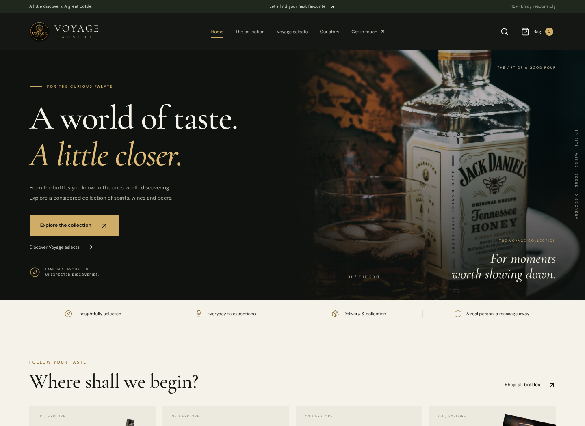

# Voyage Advent

A custom Next.js storefront for Voyage Advent, prepared for Vercel with Supabase for catalogue management, staff authentication, product images and order requests.



[Mobile preview](docs/preview-mobile.png)

## Included

- Responsive black, warm gold and cream design, self-hosted typography and local product imagery.
- 28 reference products, category/occasion/collection filters, search, sorting and product pages.
- Persistent shopping bag, quantity controls, delivery/collection checkout, adult confirmation and WhatsApp handoff.
- Supabase-backed order requests with server-priced totals, request idempotency and request throttling.
- Staff sign-in, product creation/editing, image upload, stock controls and order management.
- RLS on every application table, explicit staff membership, protected API routes, transactional stock reservation and audit records.
- Delivery, ordering help and privacy pages, metadata, robots and configurable sitemap.

## Current operating mode

**Live M-Pesa prompts are intentionally not enabled.** Checkout clearly explains that stock, delivery and payment are confirmed by the team. No payment is taken by the website.

Without Supabase environment variables, the shop reads the reference catalogue and prepares a WhatsApp message only. It does not claim to save an order or offer a working admin login. With Supabase configured, requests are persisted and managed in the dashboard. A database error is surfaced rather than silently replacing live prices with seed data.

## Develop

Use Node.js 22 or later:

```bash
npm ci
cp .env.example .env.local
npm run dev
```

The storefront is at `http://localhost:3000`; staff access is at `/admin`.

```bash
npm run typecheck
npm test
npm run build
```

The database tests run the supplied SQL in local PGlite with test Supabase roles and storage tables. They verify RLS and order/stock transitions, but do not replace a real Supabase Auth, Storage and Data API smoke test.

## Connect Supabase

1. Create or select a **dedicated Voyage Advent project**. Do not run the schema against an unrelated application.
2. In SQL Editor, run [`database/setup.sql`](database/setup.sql) **once**, then [`database/seed.sql`](database/seed.sql). The seed is safe to repeat and does not overwrite product edits.
3. In Authentication > Users, create the owner's email/password user. Use a strong password. Disable public sign-ups; this release only needs staff accounts.
4. Copy that user's UUID and run:

   ```sql
   insert into public.voyage_admins(user_id)
   values ('REPLACE_WITH_OWNER_USER_UUID');
   ```

   There is no default admin and no public role assignment. Never use user-editable metadata for staff authorisation.

5. Get the project URL, publishable key and server secret key from the project API settings. Set:

   ```dotenv
   NEXT_PUBLIC_SUPABASE_URL=https://YOUR_PROJECT.supabase.co
   NEXT_PUBLIC_SUPABASE_PUBLISHABLE_KEY=YOUR_PUBLISHABLE_KEY
   SUPABASE_SECRET_KEY=YOUR_SERVER_SECRET_KEY
   NEXT_PUBLIC_SITE_URL=https://YOUR_VERIFIED_DOMAIN
   ```

   The server secret key can also be a legacy service-role key. **Never prefix it with `NEXT_PUBLIC_`, put it in browser code, or commit it.**

6. Configure the Supabase Auth site URL for the deployed site. Test staff sign-in, image upload, a customer request and the complete order lifecycle.
7. Review Security/Performance Advisors in Supabase after setup. Anonymous customers must not be able to query orders, audit records or staff membership.

The `voyage-products` storage bucket is public for product images only. Uploads accept JPEG/PNG/WebP under 5 MB; only approved staff can upload. Customer details never belong in this bucket.

## Deploy to Vercel

1. Import `elishaoigara/voyage-advent` in Vercel.
2. Use the **Next.js** preset, root directory `.`, and Node.js 22 or 24. `vercel.json` supplies the install/build commands.
3. Add the Supabase variables above to the appropriate Vercel environments. Use a separate test project for preview/testing if working with real customer data.
4. Deploy and test `/`, `/shop`, a product, `/checkout` and `/admin`.
5. Once the chosen domain is purchased and verified, connect it and set `NEXT_PUBLIC_SITE_URL` to its HTTPS URL, then redeploy. Domain purchase and deployment are not performed by this repository.

The app can be previewed before Supabase is connected. Staff sign-in and persistent requests need the database setup. Daraja can follow later.

## Order handling

1. A request starts **pending**, with an authoritative product subtotal. It does not reserve inventory.
2. Staff confirm delivery coverage, fees and available stock.
3. Moving to **confirmed** locks relevant product rows and reserves known stock in one transaction. Insufficient stock rolls back the entire transition.
4. Move through **preparing → ready → completed**. Verify payment before completion.
5. Cancellation releases reserved stock once. It does **not** refund payments. Staff record refunds separately and retain the original payment reference.

Blank product stock means availability is checked manually. Set numerical quantities to enforce inventory limits. Set zero for out-of-stock, or hide a product without deleting historical order lines. The management view loads the latest 500 requests; add pagination/report exports when order volume needs them.

## Daraja: later integration

Environment placeholders are provided, but setting them alone will not activate payments. Keep the server payment route disabled until the client's merchant account and production credentials are verified.

Before enabling live checkout:

- Implement STK initiation against a saved, staff-confirmed order and its final amount, never a browser-supplied amount.
- Persist payment attempts and provider request IDs; enforce idempotency and retry controls.
- Implement the HTTPS callback endpoint and reconcile provider status/amount/merchant/order before marking paid. A successful prompt request is not payment confirmation.
- Test cancellation, timeouts, duplicate/delayed callbacks, mismatched amounts and repeated clicks.
- Perform a controlled live test with the merchant and confirm that funds reach the correct Paybill.

## Content and launch checks

- Prices and descriptions came from the supplied reference. Owner must confirm final catalogue and stock.
- The reference's Kenya Cane image pointed to Caribia. It is deliberately shown with a photo placeholder until the correct image is supplied. Some reference photos may show a different bottle size; verify each image against its SKU before launch.
- The homepage uses original logo artwork and a local copy of an Unsplash lifestyle image (`photo-1527281400683-1aae777175f8`). Confirm rights to supplied product/brand imagery before publishing.
- Verify phone, email and social links in `lib/config.ts`; currently taken from the reference.
- Confirm store address, operating hours, delivery zones/fees, returns/refunds, age verification and final customer policy wording. The current pages avoid invented delivery promises.
- Payment activation, real database connection, credentials, final domain purchase and production deployment remain environment-specific setup steps.
